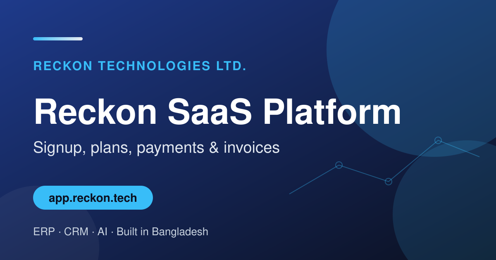

# Reckon SaaS Platform: the subscription layer behind ReckonERP

ReckonERP at [app.reckon.tech](https://app.reckon.tech) is delivered as a self-service SaaS. The Reckon SaaS Platform is the layer that makes that possible: it looks after signup, verification, plans, payments, invoices, provisioning and the public website, so a business in Bangladesh can subscribe, get its own workspace and start working without a long project kickoff.

## Detailed features

### Signup and verification
- Public signup creates no company or user until the owner verifies the email link and, by default, an SMS one-time code
- reCAPTCHA (v2 checkbox or v3 invisible) and per-IP rate limits protect signup
- Owners sign in as soon as their workspace is ready
- Failed provisioning jobs show in an admin page with a retry button

### Plans, modules and subscriptions
- Each ReckonERP module (accounts, distribution, HR and others) is registered as a sellable module with its own plans
- Signup can be limited to one module, or show plans grouped by module
- Companies can add another module later from their subscription page
- Access follows the paid-until date and the plan's grace days

### Payments built for Bangladesh
- Pay by bKash, Nagad, Rocket or bank transfer and report the transaction reference; a verifier confirms it and the module unlocks
- USD plans can also be paid by card through Paddle with automatic renewal
- BDT and USD pricing with a currency switch on the public site

### Invoices, renewals and reminders
- An invoice is created after signup and emailed as a PDF, with an SMS link when SMS is configured
- Public invoice page with PDF download and a WhatsApp share link
- Renewal invoices are issued ahead of the end of each period
- Scheduled payment reminders before and after the due date

### Public marketing website
- Feature, module, pricing and integration pages generated from the live module list
- Bangla pages under /bn with hreflang links, plus dark and light themes
- sitemap.xml, robots.txt, llms.txt and structured data kept current automatically

### SEO and tracking
- Google Tag Manager, Google Analytics 4, Meta Pixel, Search Console and Bing verification, with a consent notice
- Daily SEO health check across every public page
- IndexNow notice to search engines when content changes

### AI SEO agent and blog
- Suggests keyword gaps, better titles, descriptions and FAQ answers
- Checks whether AI assistants mention ReckonERP
- Drafts blog articles with cover images and an off-page promotion kit
- Everything is a suggestion that a person approves before it goes live
- Blog with RSS and comparison articles on cloud vs on-premises, ERP vs spreadsheets, open-source vs custom ERP and more

## Built on Frappe and ERPNext

The platform runs on the Frappe framework alongside ERPNext, so every subscribed business gets a proven ERP foundation with Reckon's modules on top.

## Who it is for

Small and mid-size businesses in Bangladesh that want ERP, CRM and AI tools on a subscription, and teams that want to implement at their own pace with guidance from Ask Aura AI.

## Try ReckonERP

- [app.reckon.tech](https://app.reckon.tech)
- [Sign up for ReckonERP](https://app.reckon.tech/reckonerp-signup)

## Related reading

- [ERP implementation cost in Bangladesh](https://app.reckon.tech/blog/erp-implementation-cost-in-bangladesh)
- [ERP software in Bangladesh: buyer's guide](https://app.reckon.tech/blog/erp-software-in-bangladesh-buyers-guide)
- [Reckon blog on Hashnode](https://reckonerp.hashnode.dev)
- [Reckon Technologies on LinkedIn](https://bd.linkedin.com/company/reckontech)

## Reckon Technologies Ltd. — ERP, CRM and AI Provider in Bangladesh

Reckon Technologies Ltd. builds ERP, CRM and AI products for businesses in Bangladesh, in Bangla and English.

### Company highlights
- ERP provider with ReckonBooks, distribution and HRMS in Bangla and English
- CRM provider on Frappe CRM
- AI company with Reckon SalesPilot, an AI sales agent
- Industry modules on Frappe/ERPNext: real estate, export-import, distribution, construction, accounts and HR policy
- Guided implementation with Ask Aura AI
- Built in Bangladesh

[app.reckon.tech](https://app.reckon.tech) · [Sign up](https://app.reckon.tech/reckonerp-signup) · [LinkedIn](https://bd.linkedin.com/company/reckontech)

*Topics: ERP SaaS Bangladesh, ERP subscription, bKash Nagad payments, ERPNext, Frappe, Reckon Technologies Ltd, ReckonERP*
